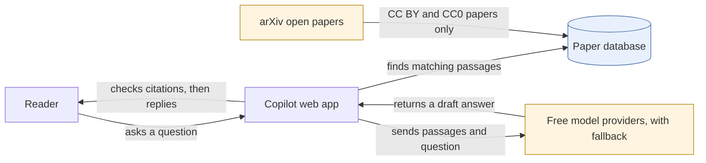

# Research Copilot

Ask a question about openly licensed information retrieval papers. Answers cite the paper and page, and code withholds any answer whose citations don't match retrieved passages.

**Try it: [research-copilot-black.vercel.app](https://research-copilot-black.vercel.app).** Pick one of the example questions and you get an answer in seconds, each citation linking to its paper on arxiv.org. Ask about something outside the papers and the answer is withheld.

Status: no production claim yet. The API runs on Render's free plan with hybrid search, because the reranker needs more than its 512 MB. After 15 idle minutes the server sleeps, and the page says so while it wakes (up to a minute). Each visitor gets 10 answers an hour and the service 200 a day, so a shared link can't use up the free model quota.

Papers come from arXiv under CC BY 4.0 or CC0. This project is not endorsed by arXiv.
