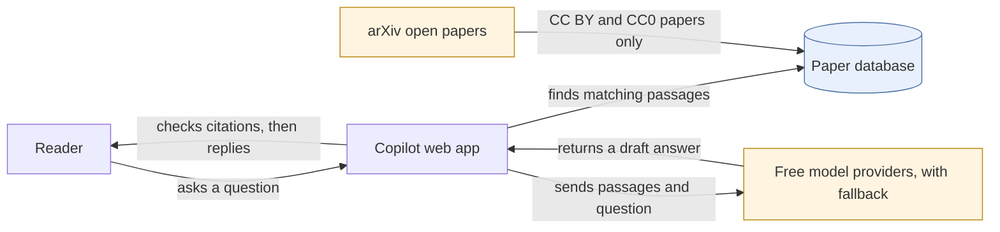

# Research Copilot

Ask a question about openly licensed information retrieval papers. Answers cite the paper and page, and code withholds any answer whose citations don't match retrieved passages.

Status: [live demo](https://research-copilot-au2k.onrender.com). No production claim yet. The free host runs hybrid search without the reranker, which needs more than its 512 MB. The first request after 15 idle minutes waits about a minute while the host wakes up.

Papers come from arXiv under CC BY 4.0 or CC0. This project is not endorsed by arXiv.
