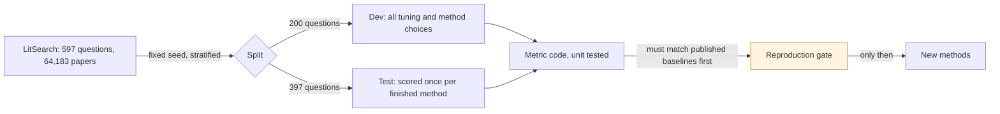

# LitSearch benchmark: pre-registered protocol

Written 2026-11-02, before any benchmark code or run. Targets and tolerances below may change only with a dated note saying why, in the change log at the bottom.

## Data
- Source: `princeton-nlp/LitSearch` on Hugging Face, configs `query` and `corpus_clean`. The dataset card states no licence, so it is used for offline benchmarking only and never served by the live app.
- Document text: title, a blank line, then abstract. Papers with no abstract are scored on the title alone.
- Gold: the `corpusids` list for each question. Questions whose gold papers are missing from the corpus are reported, not silently dropped.

## Split
- 200 dev questions, 397 test questions, fixed seed 13.
- Stratified by `query_set` and `specificity`, so each stratum's share in dev is within one question of its share overall.
- Methods are designed and tuned on dev only. Test is scored once a method is final. Full-set (597) numbers are reported only for comparison with papers that used all questions.

## Metrics
For one question with gold set G and ranked list R (duplicates removed, first occurrence kept):
- Recall@k = |G ∩ R[:k]| / |G|
- nDCG@k with binary relevance: DCG = Σ 1/log2(i+1) over positions i ≤ k holding a gold paper; ideal DCG uses min(|G|, k) hits. nDCG = DCG / ideal.
- Reported as the mean over questions, as percentages with one decimal.
- Headline: Recall@20 and nDCG@10. Diagnostic: Recall@100, the ceiling for any reranker.
- Breakdowns: specificity (broad, specific), `query_set`, and questions whose gold paper has no abstract.

## Reproduction gate (must pass before any new method counts)
| Baseline | Metric, all 597 | Published | Tolerance | Source |
|---|---|---|---|---|
| BM25, title + abstract | nDCG@10 | 40.2 | ± 2.0 | CASPER, arXiv 2508.13394, Table 2 |
| Qwen3-Embedding-8B | Recall@20 | 79.2 | ± 2.0 | PairSem, arXiv 2510.09897, Table 1 |
| Qwen3-Embedding-8B | nDCG@10 | 58.0 | ± 2.0 | Same |

The tolerance is wide because neither paper states its tokenizer, BM25 settings or query instruction. Missing a target means the metric or data code is wrong until shown otherwise. If an 8B model can't run on this machine, a smaller model runs instead and the reproduction row is marked not attempted rather than passed.

## Win condition
A method beats the published state of the art only if, on the **test split** and the **full 597**, both:
- Recall@20 > 81.8 (PairSem with Qwen3-Embedding-8B, the best found on 2026-11-02)
- nDCG@10 > 61.1 (same)

A test-split margin under 3 points is reported as "not clearly better", since 397 questions give roughly ±4 points of sampling error at these rates.

## Rules
- Each new stage must beat the stage before it on dev, or it is switched off.
- LLM query expansion, if tried, is reported apart from the headline, because the model may have read these papers.
- Every run records model, settings, seed, date and cost.

## Cross-hardware check (Kaggle)
The 8B model doesn't fit this Mac, so it runs on Kaggle's two T4 GPUs at fp16, which T4s need because they have no bf16. Before any Kaggle 8B number counts, the same Kaggle run first scores Qwen3-Embedding-0.6B with the Mac's settings (1,024 tokens, batches of 8). Its Recall@20 must be within **1.0 point** of the Mac's 75.0 and its nDCG@10 within 1.0 of 53.1. A miss means the hardware or precision is changing scores, and the 8B result is reported as unverified.

## Change log
- 2026-11-02: first version.
- 2026-11-02: added the Kaggle cross-hardware check, before the first Kaggle run.
- 2026-11-03: the Kaggle 8B run scored Recall@20 81.6 and nDCG@10 62.8, outside the gate on the high side. PairSem does not state its query instruction, and on the 0.6B dropping the instruction costs 5.2 Recall@20 and 5.3 nDCG@10. Hypothesis, recorded before testing it: PairSem ran Qwen3-8B on raw queries. Test: one Kaggle run that reuses our 8B paper vectors and scores (a) the protocol instruction, which must match the stored 81.6 / 62.8 within 0.1, proving the reused vectors are the same, then (b) raw queries. The hypothesis holds if (b) is within ±2.0 of 79.2 / 58.0. That (a) check replaces the 0.6B cross-hardware check for this run, since no papers are re-encoded. Either way the win condition stays 81.8 / 61.1, and our 8B with the instruction is the baseline any new method must beat.
- 2026-11-03, outcome: the reused vectors reproduced 81.6 / 62.8 exactly, so check (a) passed. Raw queries scored Recall@20 76.6 and nDCG@10 55.5, which is 2.6 and 2.5 below PairSem's 79.2 / 58.0, outside ±2.0. By the rule above the hypothesis is not supported. PairSem's setup sits between our raw and instructed runs, and we still don't know how it ran. The reproduction gate stays failed for the 8B, reported as such.
- 2026-11-03, last reproduction attempt, recorded before running it: the instruction Qwen ships in config_sentence_transformers.json, "Given a web search query, retrieve relevant passages that answer the query", which sentence-transformers adds with prompt_name="query". Same reused vectors, same (a) check. It explains PairSem's baseline if both scores are within ±2.0 of 79.2 / 58.0. This is the final setup tried: whatever it shows, the 8B gate is then reported as passed or failed under that setup, and no further setups are searched, since trying setups until one matches would make any match meaningless.
