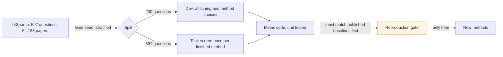

# LitSearch benchmark: pre-registered protocol

Written 2026-11-02, before any benchmark code or run. Targets and tolerances below may change only with a dated note saying why, in the change log at the bottom.

## Data
- Source: `princeton-nlp/LitSearch` on Hugging Face, configs `query` and `corpus_clean`. The dataset card states no licence, so it is used for offline benchmarking only and never served by the live app.
- Document text: title, a blank line, then abstract. Papers with no abstract are scored on the title alone.
- Gold: the `corpusids` list for each question. Questions whose gold papers are missing from the corpus are reported, not silently dropped.

## Split
- 200 dev questions, 397 test questions, fixed seed 13.
- Stratified by `query_set` and `specificity`, so each stratum's share in dev is within one question of its share overall.
- Methods are designed and tuned on dev only. Test is scored once a method is final. Full-set (597) numbers are reported only for comparison with papers that used all questions.

## Metrics
For one question with gold set G and ranked list R (duplicates removed, first occurrence kept):
- Recall@k = |G ∩ R[:k]| / |G|
- nDCG@k with binary relevance: DCG = Σ 1/log2(i+1) over positions i ≤ k holding a gold paper; ideal DCG uses min(|G|, k) hits. nDCG = DCG / ideal.
- Reported as the mean over questions, as percentages with one decimal.
- Headline: Recall@20 and nDCG@10. Diagnostic: Recall@100, the ceiling for any reranker.
- Breakdowns: specificity (broad, specific), `query_set`, and questions whose gold paper has no abstract.

## Reproduction gate (must pass before any new method counts)
| Baseline | Metric, all 597 | Published | Tolerance | Source |
|---|---|---|---|---|
| BM25, title + abstract | nDCG@10 | 40.2 | ± 2.0 | CASPER, arXiv 2508.13394, Table 2 |
| Qwen3-Embedding-8B | Recall@20 | 79.2 | ± 2.0 | PairSem, arXiv 2510.09897, Table 1 |
| Qwen3-Embedding-8B | nDCG@10 | 58.0 | ± 2.0 | Same |

The tolerance is wide because neither paper states its tokenizer, BM25 settings or query instruction. Missing a target means the metric or data code is wrong until shown otherwise. If an 8B model can't run on this machine, a smaller model runs instead and the reproduction row is marked not attempted rather than passed.

## Win condition
A method beats the published state of the art only if, on the **test split** and the **full 597**, both:
- Recall@20 > 81.8 (PairSem with Qwen3-Embedding-8B, the best found on 2026-11-02)
- nDCG@10 > 61.1 (same)

A test-split margin under 3 points is reported as "not clearly better", since 397 questions give roughly ±4 points of sampling error at these rates.

## Rules
- Each new stage must beat the stage before it on dev, or it is switched off.
- LLM query expansion, if tried, is reported apart from the headline, because the model may have read these papers.
- Every run records model, settings, seed, date and cost.

## Cross-hardware check (Kaggle)
The 8B model doesn't fit this Mac, so it runs on Kaggle's two T4 GPUs at fp16, which T4s need because they have no bf16. Before any Kaggle 8B number counts, the same Kaggle run first scores Qwen3-Embedding-0.6B with the Mac's settings (1,024 tokens, batches of 8). Its Recall@20 must be within **1.0 point** of the Mac's 75.0 and its nDCG@10 within 1.0 of 53.1. A miss means the hardware or precision is changing scores, and the 8B result is reported as unverified.

## Citation-graph stage: generalisation rules
Written 2026-11-03, before any graph method is built. LitSearch's own authors note that for ACL-sourced inline questions the source paper can be in the corpus, so following citations can exploit how the dataset was built. On dev with the 0.6B, one-hop reach of missed gold papers was 17 of 26 for inline questions and 1 of 17 for author-written ones.

Question groups, from `query_set`:
- **citation-generated, source not in corpus**: `inline_nonacl`
- **author-written**: `manual_acl` and `manual_iclr`, the closest to real searches
- **citation-generated, source may be in corpus**: `inline_acl`, reported but never counted toward a pass

A graph method passes on dev only if, against the dense first stage on the same questions:
1. Recall@20 and nDCG@10 both rise on all dev questions.
2. Both rise on `inline_nonacl`.
3. Neither falls by more than 1.0 point on the author-written group. The 1.0 allows for noise, since that group has 82 dev questions.

Search limits:
- Each method first runs with its paper's published settings. A setting that must be tuned gets at most three values, all on dev.
- Every configuration tried is logged in `bench/results/ablations/graph/`, and the write-up states the count.
- Between methods that both pass, the one with fewer free settings wins; a tie on that goes to the higher dev nDCG@10.
- The chosen method is scored on the test split once, with the same three rules applied there. Missing any of them there is reported as a failure, not retuned.
- A benchmark whose relevance labels come from citations, such as ScifullBench, cannot test this stage, since any graph method wins by construction.

### Method 1: one-hop expansion (LitSearch, arXiv 2407.18940, section 4)
Recorded before building it. Published settings, none tuned:
- The 8B with the protocol instruction gives the dense ranking.
- Seeds are its top m = 50.
- The list is interleaved: seed 1, then the papers it cites (references only, not citing papers), then seed 2 and its references, and so on, skipping duplicates and keeping the first copy.
- The list is cut at n = 200.

Screening step, no LLM: a reranker can only order what is in the pool, so the one-hop pool is compared with the dense top 200, a pool of equal size, by Recall@200 on dev. One-hop goes on to the LLM rerank only if its pool passes the same three rules as above, with Recall@200 in place of both metrics. Otherwise it is dropped and the LLM calls are not spent. Recall@20 and nDCG@10 of the interleaved list as it stands are reported too, as a diagnostic.

### Method 2: structural re-ranking over citations
Recorded before building it. Method 1 showed the dense top 200 already holds 98% of dev gold papers, so this method adds no candidates and only reorders them.
- **Graph.** The citation links among the dense top 200, directed from citing paper to cited paper. Links to papers outside the 200 are ignored.
- **Centrality.** PageRank over that graph, after Kurland and Lee, SIGIR 2005 ("PageRank without hyperlinks"), with damping 0.85 (Brin and Page) and a uniform teleport. Papers with no outgoing links spread their score uniformly.
- **Fusion.** Reciprocal-rank fusion of the dense order and the PageRank order, 1/(60 + rank) each, with k = 60 from Cormack, Clarke and Buettcher, SIGIR 2009, and equal weights. Ties in either order, and in the fused score, go to the better dense rank.

No setting is tuned, so this is one configuration. It passes if it meets the three generalisation rules on Recall@20 and nDCG@10 against the dense 8B on dev.

### Method 3: score regularisation over citations
Recorded before building it. After Diaz, "Regularizing ad hoc retrieval scores", CIKM 2005. Method 2 failed because its graph signal ignored the question; this one smooths the dense scores themselves, so it starts from the question.
- **Graph.** The dense top 200, with an undirected link wherever one paper cites the other. Each paper's links are weighted equally and sum to 1. A paper with no link to another candidate links only to itself, so it keeps its own score.
- **Scores.** f0 is each candidate's dense cosine score. The result is the fixed point of f = (1 - a) f0 + a W f, that is f = (1 - a)(I - a W)^-1 f0, ranked by f with ties going to the better dense rank.
- **Weight.** The paper gives no standard a, so three values, fixed now: 0.1, 0.3 and 0.5, which makes 3 configurations.
- **Selection.** Each value is checked against the three generalisation rules on dev. If more than one passes, the highest dev nDCG@10 is chosen, and its test-split result is reported with the note that 3 values were tried. If none passes, the method is dropped.

## Reranker stage
Recorded 2026-11-03, before any reranker call. On dev, the dense 8B top 200 holds 98.0% of gold papers but its top 20 only 85.2%, so the remaining gap is ordering.

Configuration 1, LitSearch's "vanilla" reranker (arXiv 2407.18940, section 4), adapted from RankGPT (Sun et al., 2023):
- **Candidates.** The dense 8B's top 100, with protocol instruction, shown as "[i] title and abstract" in dense order. Anything past 100 keeps its place.
- **Calls.** One listwise call per question, asking for "[a] > [b] > ..." with no explanation, temperature 0.
- **Model.** gemini-3.5-flash, pinned with no fallback provider; LitSearch used GPT-4o, which is paid. It was chosen on 2026-11-03 as the strongest model the free tier answered: gemini-3.8-flash timed out.
- **Parsing.** Out-of-range and repeated ids are dropped, and any ids the model left out follow in dense order. A reply with no ids keeps the dense order and is counted as a failure. More than 2% failures makes the run invalid, since that would be a broken setup rather than a result.
- **Cache.** Every prompt and reply is cached on disk, so a rerun repeats the same replies and each one can be audited.

Pass rule: the same three generalisation rules as the citation-graph stage, on Recall@20 and nDCG@10 against the dense 8B on dev. If it fails, the reranker is dropped, or a second configuration is pre-registered here before it runs.

Caveat recorded in advance: LitSearch was published in July 2024, and its papers are public. The model may have seen both, which would make any gain partly memory. This can't be ruled out, and the result will be reported with the caveat.

### Reranker configuration 2: Qwen3-Reranker-4B
Recorded 2026-11-03, before it runs, after configuration 1 hit Gemini's free-tier cap of 20 requests a day. The setup follows the Qwen3-Reranker-4B model card:
- **Template.** The ChatML template with the system line "Judge whether the Document meets the requirements based on the Query and the Instruct provided. Note that the answer can only be "yes" or "no".", then "<Instruct>: {instruction}\n<Query>: {query}\n<Document>: {doc}", then an assistant turn opening with an empty think block.
- **Score.** P(yes) from a softmax over the "yes" and "no" logits at the last position. Left padding.
- **Instruction.** The protocol task, "Given a scientific literature search query, retrieve relevant papers". The card recommends a task-specific one, and the same text beat Qwen's default by 2.3 / 2.4 on the 8B embedder.
- **Inputs.** The dense 8B's top 100, title and abstract, each pair capped at 1,024 tokens. Only the document is truncated, never the template.
- **Order.** Sorted by score, ties going to the better dense rank. Anything past 100 keeps its place.
- **Hardware.** float16 on the Mac's GPU, with the same NaN check as the encoder. Scores are cached per question.

Why the 4B: on the card, the 4B reranking a Qwen3 embedder's top 100 scores 69.76 on MTEB-R, against 69.02 for the 8B, at half the size.

Pass rule: the same three generalisation rules, on Recall@20 and nDCG@10 against the dense 8B on dev. This scores each paper on its own, unlike LitSearch's listwise GPT-4o, so a result here is not a reproduction of their reranker.

## Change log
- 2026-11-02: first version.
- 2026-11-02: added the Kaggle cross-hardware check, before the first Kaggle run.
- 2026-11-03: the Kaggle 8B run scored Recall@20 81.6 and nDCG@10 62.8, outside the gate on the high side. PairSem does not state its query instruction, and on the 0.6B dropping the instruction costs 5.2 Recall@20 and 5.3 nDCG@10. Hypothesis, recorded before testing it: PairSem ran Qwen3-8B on raw queries. Test: one Kaggle run that reuses our 8B paper vectors and scores (a) the protocol instruction, which must match the stored 81.6 / 62.8 within 0.1, proving the reused vectors are the same, then (b) raw queries. The hypothesis holds if (b) is within ±2.0 of 79.2 / 58.0. That (a) check replaces the 0.6B cross-hardware check for this run, since no papers are re-encoded. Either way the win condition stays 81.8 / 61.1, and our 8B with the instruction is the baseline any new method must beat.
- 2026-11-03, outcome: the reused vectors reproduced 81.6 / 62.8 exactly, so check (a) passed. Raw queries scored Recall@20 76.6 and nDCG@10 55.5, which is 2.6 and 2.5 below PairSem's 79.2 / 58.0, outside ±2.0. By the rule above the hypothesis is not supported. PairSem's setup sits between our raw and instructed runs, and we still don't know how it ran. The reproduction gate stays failed for the 8B, reported as such.
- 2026-11-03, last reproduction attempt, recorded before running it: the instruction Qwen ships in config_sentence_transformers.json, "Given a web search query, retrieve relevant passages that answer the query", which sentence-transformers adds with prompt_name="query". Same reused vectors, same (a) check. It explains PairSem's baseline if both scores are within ±2.0 of 79.2 / 58.0. This is the final setup tried: whatever it shows, the 8B gate is then reported as passed or failed under that setup, and no further setups are searched, since trying setups until one matches would make any match meaningless.
- 2026-11-03, outcome of the last attempt: check (a) reproduced 81.6 / 62.8 exactly. Qwen's shipped web-search prompt scored Recall@20 79.25 (PairSem 79.2, within 0.1) and nDCG@10 60.4 (PairSem 58.0, 2.4 above, outside ±2.0). By the rule it does not explain PairSem's baseline, so the 8B reproduction gate is reported as failed: Recall@20 reproduced under Qwen's default prompt, nDCG@10 did not, and PairSem's setup is not stated. No further setups will be tried. Our baseline stays the protocol instruction at 81.6 / 62.8, which beats Qwen's default prompt by 2.3 Recall@20 and 2.4 nDCG@10.
- 2026-11-03: added the citation-graph generalisation rules, before any graph method was built or run.
- 2026-11-03: pre-registered method 1, one-hop expansion, with its no-LLM screening step.
- 2026-11-03, method 1 outcome: one-hop fails the screening step and is dropped. On dev, the dense 8B top 200 already holds 98.0% of gold papers. The one-hop pool holds 91.2%, and it is lower in every group: source not in corpus 97.6 to 90.6, author-written 98.8 to 91.5. As-is it also cuts Recall@20 from 85.2 to 72.0. Configurations tried: 1. Result in bench/results/ablations/graph/one-hop-m50-n200-dev.json.
- 2026-11-03: pre-registered method 2, structural re-ranking over citations.
- 2026-11-03, method 2 outcome: structural re-ranking fails and is dropped. On dev, nDCG@10 fell from 65.7 to 32.7 overall and from 67.5 to 16.6 on author-written questions, failing rules 1 and 3. Recall@20 fell from 85.2 to 81.7; its only rise was on source-not-in-corpus questions, 82.9 to 83.5. Cause, checked on dev: in 108 questions the dense rank-1 paper is gold, and after re-ranking it moves to a median rank of 7. Its place goes to papers widely cited within the pool. Equal-weight fusion with a query-blind centrality promotes popular papers over the specific answer. Configurations tried: 1, so 2 in total across graph methods.
- 2026-11-03: pre-registered method 3, score regularisation, with its three weights.
- 2026-11-03, method 3 outcome: no weight passes, so score regularisation is dropped. Dev overall, Recall@20 / nDCG@10 against 85.2 / 65.7: a=0.1 gives 85.2 / 66.0, a=0.3 gives 85.5 / 65.5, a=0.5 gives 84.3 / 61.8. No weight raises both metrics overall (rule 1), and every weight lowers nDCG@10 on source-not-in-corpus questions (rule 2): 64.4 to 64.0, 62.0 and 56.9. Author-written questions rose at every weight (nDCG@10 67.5 to 68.5, 70.2 and 68.6), the reverse of the expected artifact. With 82 questions that is within noise, and it is recorded here, not acted on. Configurations tried: 3, so 5 in total across graph methods. All three published families tried here failed on the 8B.
- 2026-11-03: pre-registered reranker configuration 1, LitSearch's vanilla listwise rerank with gemini-3.5-flash.
- 2026-11-03, reranker configuration 1 stopped at 11 of 200 dev questions. The free tier allows gemini-3.5-flash 20 requests a day per project (quota GenerateRequestsPerDayPerProjectPerModel-FreeTier, read from the 429 reply), so the 200 dev questions would take 10 days and the 397 test questions 20 more. The 11 replies stay cached and are not scored, since a partial run is not a result.
- 2026-11-03: pre-registered reranker configuration 2, Qwen3-Reranker-4B.
- 2026-11-04, reranker configuration 2 outcome: Qwen3-Reranker-4B passes all three generalisation rules on dev, 200 of 200 questions, 0 failures. Recall@20 / nDCG@10, dense 8B to reranked: overall 85.2 / 65.7 to 89.7 / 70.3 (rule 1); source not in corpus 82.9 / 64.4 to 86.5 / 65.9 (rule 2); author-written 85.4 / 67.5 to 95.1 / 79.0 (rule 3, no fall). Recall@100 is unchanged in every group (95.4 overall), as it must be when only the top 100 is reordered. The uncounted inline_acl group fell, 90.3 / 64.8 to 84.6 / 60.0 on 33 questions; not acted on. Configurations tried: 2 in the reranker stage (configuration 1 unscored). Result in bench/results/ablations/rerank/qwen3-reranker-4b-top100-dev.json. Run time 10.2 hours on the Mac.
- 2026-11-04, recorded before the test run: configuration 2 is final and is scored once on the 397 test questions, then on the full 597 (dev scores reused from cache), unchanged from the dev run. It beats the published state of the art only if both splits clear Recall@20 > 81.8 and nDCG@10 > 61.1; a test margin under 3 is "not clearly better". Whatever the result, no reranker setting is changed and test is not rescored.
- 2026-11-04, test and full outcome for reranker configuration 2, scored once, 0 failures. Test (397), dense 8B to reranked: Recall@20 79.8 to 85.3, nDCG@10 61.3 to 64.1. Full (597): Recall@20 81.6 to 86.8, nDCG@10 62.8 to 66.2. Both splits clear the win condition (81.8 / 61.1). On test the Recall@20 margin is 3.5, but the nDCG@10 margin is 2.99, under 3, so by the rule above the result is "not clearly better" on nDCG@10. By group on test: author-written 88.4 / 70.4 to 95.1 / 77.3; source not in corpus 74.1 / 55.6 to 78.9 / 53.0, so nDCG@10 fell 2.6 there, which dev (64.4 to 65.9) did not show; inline_acl 72.6 / 53.0 to 77.2 / 59.4. The full set includes the 200 dev questions this configuration was chosen on. Results in bench/results/ablations/rerank/qwen3-reranker-4b-top100-{test,full}.json. Test run time 4.1 hours.
