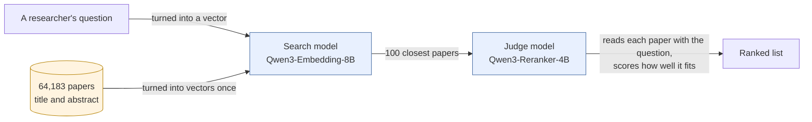

# Finding the paper a researcher means

On LitSearch, a public benchmark of 597 real literature-search questions over 64,183 ML and NLP papers, this pipeline puts the right paper in the top 20 for **85.3%** of held-out questions. The best published result I found is 81.8% (PairSem, arXiv 2510.09897, January 2026). It runs on two open Qwen3 models and free compute: a MacBook and a Kaggle notebook.



## Result

All choices were made on 200 development questions. The other 397 were scored once, at the end, under rules written down before the run ([bench/BENCHMARK.md](../bench/BENCHMARK.md)).

| Held-out test, 397 questions | Right paper in top 20 (Recall@20) | Ranking quality (nDCG@10) |
|---|---|---|
| PairSem, best published | 81.8 | 61.1 |
| Search model alone | 79.8 | 61.3 |
| **Search model + judge model** | **85.3** | **64.1** |

On all 597 questions the pipeline scores 86.8 / 66.2.

LitSearch's own paper ranks with GPT-4o and reports different metrics. Against it, this pipeline wins on broad questions (79.1 against 75.3, Recall@20) and loses on specific ones (76.8 against 79.2, Recall@5). The whole loss is on questions taken from a citing sentence in another paper, where finding *the* cited paper matters more than finding a relevant one.

## What didn't work

Three published ways of using the citation graph, each tried and dropped under the same pre-written rules:

1. Adding papers one citation hop away, as LitSearch does, cut recall from 85.2 to 72.0. The search model already had 98% of the right papers in its top 200.
2. Re-ranking by citation centrality pushed popular papers over the specific answer. Ranking quality fell from 65.7 to 32.7.
3. Smoothing scores along citations gave no gain that held on the questions that matter most.

A free-tier Gemini judge was also tried and stopped: the free quota allows 20 requests a day.

## Next step, screened

On the 53 development questions where GPT-4o still wins, a free LLM (Nemotron 3 Ultra on OpenRouter) re-ordered the judge model's top 20 papers by reading them side by side. The right paper reached the top 5 on 84.9% of them, up from 77.4%: 4 questions improved and none got worse. That is a screen under a rule written in advance, not a result. Four questions is a small count (sign test p = 0.06), and the free tier allows about 50 calls a day, so a full run on all 200 development questions takes 4 days.

## Citations in the demo's answers

The demo is a separate, small app over 299 openly licensed IR papers. Its code withholds an answer that cites a passage it was not given, but it does not check that the passage backs the sentence. To measure that, the demo answered 120 reviewed questions (94 answered, 26 refused), and 50 of the 217 citations in those answers were sampled at random.

Two AI labellers, working separately with the same rubric, marked **40 of 50 (80%, 95% interval 67 to 89%)** as fully supported by the cited passage. They agreed on 44 of 50 (Cohen's kappa 0.54). Only 2 were marked unsupported by either: one names a protein the passage never mentions, the other states a 2 to 4% figure the passage does not give. Most of the rest add a detail the passage lacks, such as "80% power" and "5 raters" in a sentence whose passage gives only the sample size and the detectable effect. These are AI judgements, not a human check; the labels and reasons are in [evals/results](../evals/results/2026-11-03-citation-labels.json).

## Caveats

- The nDCG@10 lead on test is 2.99 points, just under the 3-point margin set in advance as "clearly better". Recall@20 clears it.
- PairSem's own baseline does not reproduce: the same search model scores 81.6 / 62.8 here and 79.2 / 58.0 in their paper. Some of the lead may be setup rather than method.
- Both Qwen3 models were released after LitSearch was public, so they may have seen its papers.

## Reproduce

```bash
uv sync --group bench
HF_HUB_OFFLINE=1 uv run --group bench python bench/rerank/run.py --reranker qwen3-4b --split test
HF_HUB_OFFLINE=1 uv run --group bench python bench/rerank/native.py
```

Result files are in [bench/results/ablations/rerank](../bench/results/ablations/rerank). The paper vectors were built on a free Kaggle GPU; reranking the test split took 4.1 hours on a MacBook.
