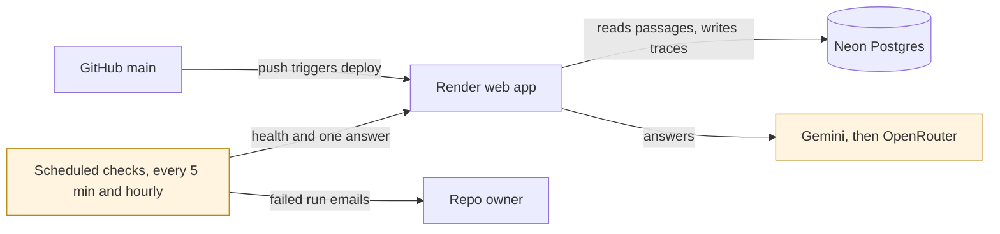

# Runbook

Live: demo page https://research-copilot-black.vercel.app (Vercel, deployed from `web/` with `npx vercel deploy --prod`), API https://research-copilot-au2k.onrender.com (Render free, Singapore), database on Neon (free, ap-southeast-1). The API only accepts browser calls from the origins in `WEB_ORIGINS`.



## Roll back a bad deploy (target: under 5 minutes)
1. Render dashboard, open `research-copilot`, then **Events**.
2. Find the last good deploy and click **Rollback**.
3. Confirm `curl -fsS https://research-copilot-au2k.onrender.com/health` returns `{"status":"ok"}`.
4. Run **Synthetic checks** by hand from the GitHub Actions tab and confirm the answer job passes.
5. Record the start time, end time and the commit rolled back to in `docs/drills.md`.

A rollback doesn't undo schema changes. Every migration in `schema.sql` must stay safe for the previous release to run against.

## When the checks fail
| Symptom | Likely cause | First step |
|---|---|---|
| Health fails, restarts in Render logs with no traceback | Out of memory | Check `SEARCH_MODE` is `hybrid`, see the last deploy's changes |
| Answers return 503 "providers are unavailable" | Gemini and OpenRouter both failing or out of quota | Check `provider failed` log lines for the status code |
| Answers return 429 "asked a lot this hour" | One IP passed `ANSWERS_PER_IP_PER_HOUR` | Expected. The count lives in memory and resets on restart |
| Demo page shows "request failed" | `WEB_ORIGINS` on Render is missing the Vercel URL | Check the CORS preflight from the page origin |
| Answers return 503 "quota is used up" | `DAILY_ANSWER_CAP` reached | Expected. Check traces for one heavy user |
| Many `citation_check_failed` traces | Model or prompt change | Read `model_output` on those traces |

```sql
SELECT outcome, provider, count(*), percentile_cont(0.95) WITHIN GROUP (ORDER BY latency_ms)
FROM traces WHERE created_at > now() - interval '1 day' GROUP BY 1, 2;
```
