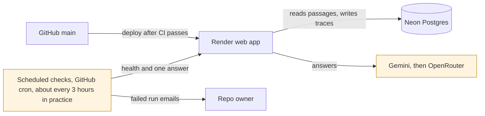

# Runbook

Live: demo page https://research-copilot-black.vercel.app (Vercel, deployed from `web/` with `npx vercel deploy --prod`), API https://research-copilot-au2k.onrender.com (Render free, Singapore), database on Neon (free, ap-southeast-1). The API only accepts browser calls from the origins in `WEB_ORIGINS`.



## Targets
These come from the synthetic checks, the only continuous signal there is. The numbers were set below what was measured, so a breach means something changed.

| Target | Over | Measured so far |
|---|---|---|
| At least 98% of synthetic runs succeed | rolling 30 days | 114 of 115 (99.1%), 2026-11-02 to 2026-11-17 |
| The hourly answer returns `answered` in 40 seconds or less, at least 95% of the time | rolling 30 days | 18 of 18 sampled; too few runs to say more |

Check the first one:

```bash
gh run list --workflow synthetic.yml --limit 300 --json conclusion,createdAt -q '[.[]|select(.conclusion=="success" or .conclusion=="failure")] | "\([.[]|select(.conclusion=="success")]|length) of \(length) runs succeeded since \(.[-1].createdAt[0:10])"'
```

If a target is missed, open the failed runs, find the cause in the table below, and write what you found next to the date in `docs/drills.md`.

GitHub runs these about every 3 hours, not every 5 minutes, so an outage can last hours before anyone is told. GitHub also stops scheduled workflows after 60 days without repository activity. If the Actions tab shows no recent runs, push any commit and re-enable the workflow there. An external uptime monitor would remove both limits (ledger RC11).

## Roll back a bad deploy (target: under 5 minutes)
1. Render dashboard, open `research-copilot`, then **Events**.
2. Find the last good deploy and click **Rollback**.
3. Confirm `curl -fsS https://research-copilot-au2k.onrender.com/health` returns `{"status":"ok"}`.
4. Run **Synthetic checks** by hand from the GitHub Actions tab and confirm the answer job passes.
5. Record the start time, end time and the commit rolled back to in `docs/drills.md`.

If you change `MODEL` in `embed.py` (or upgrade `fastembed`), re-embed every stored chunk first. Query and passage vectors from different models are not comparable, nothing errors, and retrieval just gets worse.

A rollback doesn't undo schema changes. Every migration in `schema.sql` must stay safe for the previous release to run against.

## When the checks fail
| Symptom | Likely cause | First step |
|---|---|---|
| Health fails, restarts in Render logs with no traceback | Out of memory | Check `SEARCH_MODE` is `hybrid`, see the last deploy's changes |
| Answers return 503 "providers are unavailable" | Gemini and OpenRouter both failing or out of quota | Check `provider failed` log lines for the status code |
| Answers return 429 "asked a lot this hour" | One IP passed `ANSWERS_PER_IP_PER_HOUR` | Expected. The count lives in memory and resets on restart |
| Demo page shows "request failed" | `WEB_ORIGINS` on Render is missing the Vercel URL | Check the CORS preflight from the page origin |
| Answers return 503 "database is unavailable" | Neon is down, asleep too long or the URL changed | Check the Neon dashboard, then `DATABASE_URL` on Render |
| Answers return 500 "Something went wrong" | An unexpected error; the stack trace is in the Render logs and the trace row says `internal_error` | Read the log line `unexpected error answering a question` |
| Answers return 503 "quota is used up" | `DAILY_ANSWER_CAP` reached | Expected. Check traces for one heavy user |
| Many `citation_check_failed` traces | Model or prompt change | Read `model_output` on those traces |

```sql
SELECT outcome, provider, count(*), percentile_cont(0.95) WITHIN GROUP (ORDER BY latency_ms)
FROM traces WHERE created_at > now() - interval '1 day' GROUP BY 1, 2;
```
